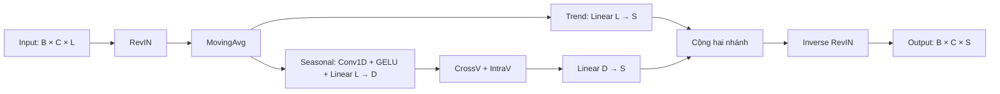

# DyTimeNet v2

Dự báo chuỗi thời gian đa biến bằng PyTorch trên **ETTh1, ETTh2, ETTm1, ETTm2 và Weather**.
Bản triển khai của đồ án dùng CrossV/IntraV, DropFusion, tách trend/seasonal và depthwise Conv1D.

## Chạy nhanh

Chạy các lệnh từ **thư mục gốc dự án**. Dùng Python 3.10–3.13; các thư viện runtime
được cố định phiên bản trong [requirements.txt](requirements.txt).

```powershell
python -m venv .venv
.\.venv\Scripts\Activate.ps1
python -m pip install -r requirements.txt
```

Trên Linux/macOS, thay lệnh kích hoạt bằng `source .venv/bin/activate`.
Nếu dùng GPU, cài bản PyTorch phù hợp CUDA; `--device auto` chọn CUDA nếu có, còn lại dùng CPU.

Tải CSV theo [hướng dẫn dữ liệu](data/README.md), rồi huấn luyện:

```bash
python scripts/train.py --config configs/ETTm2.yaml --pred_len 96
```

Lệnh này huấn luyện, chọn checkpoint theo validation loss rồi đánh giá trên test.
Kết quả nằm trong `checkpoints/ETTm2_L96_S96_seed42_<timestamp>/`.
Để đánh giá lại, thay `<run_dir>` bằng tên thư mục được in ở cuối lệnh train:

```bash
python scripts/evaluate.py --checkpoint checkpoints/<run_dir>/best.pt
```

## Đọc mã nguồn theo thứ tự nào?

| Thứ tự | File | Vai trò |
| --- | --- | --- |
| 1 | [scripts/train.py](scripts/train.py) | Điểm bắt đầu: nhận CLI, đọc config, gọi train |
| 2 | [config.py](src/dytimenet/config.py) | Giá trị mặc định, kiểm tra tham số, ưu tiên CLI |
| 3 | [experiment.py](src/dytimenet/experiment.py) | Điều phối dữ liệu → model → train → lưu → test |
| 4 | [data/dataset.py](src/dytimenet/data/dataset.py) | Đọc CSV, chia tập, chuẩn hóa, tạo sliding window |
| 5 | [models/dytimenet.py](src/dytimenet/models/dytimenet.py) | Kiến trúc và luồng `forward()` |
| 6 | [layers/](src/dytimenet/layers/) | RevIN, MovingAvg, CrossV và IntraV |
| 7 | [engine/trainer.py](src/dytimenet/engine/trainer.py) | Một epoch, lịch learning rate, early stopping |
| 8 | [engine/evaluate.py](src/dytimenet/engine/evaluate.py) | Tính MSE/MAE/RMSE và in kết quả |

Đầu vào `[B, C, L]`, đầu ra `[B, C, S]`: `B` là batch size, `C` là số biến,
`L = seq_len` là độ dài quá khứ, `S = pred_len` là số bước dự báo.



CrossV học quan hệ giữa các biến; IntraV học trên chiều biểu diễn thời gian `D = d_model`.
DropFusion áp dụng DropEdge lên trọng số và DropNeuron lên đầu ra khi train.
Model giữ phép cộng `s = cross_v(s) + s` của bản v2, ngoài residual bên trong CrossVBlock.

## Cấu hình thí nghiệm

[configs/](configs/) chứa phần cấu hình riêng cho từng dataset. Những tham số còn lại
lấy từ `ExperimentConfig` trong [config.py](src/dytimenet/config.py), tránh lặp lại ở 5 YAML.
Thứ tự ưu tiên: **mặc định Python < YAML < CLI**. Đường dẫn tương đối tính từ nơi chạy lệnh.

| Dataset | d_model | batch_size | p1 | p2 |
| --- | ---: | ---: | ---: | ---: |
| ETTh1 | 64 | 64 | 0.1 | 0.1 |
| ETTh2 | 64 | 64 | 0.6 | 0.6 |
| ETTm1 | 64 | 32 | 0.1 | 0.2 |
| ETTm2 | 32 | 64 | 0.1 | 0.1 |
| Weather | 64 | 64 | 0.1 | 0.1 |

Mặc định chung: `seq_len=96`, `pred_len=192`, `epochs=100`, `lr=0.0005`,
`patience=10`, `warmup_epochs=2`, `num_layers=1`, `decomp_kernel=25`, `seed=42`.
Các horizon dùng trong đồ án: **96 / 192 / 336 / 720**.

```bash
python scripts/train.py --config configs/Weather.yaml --pred_len 336 --epochs 50 --seed 7
python scripts/train.py --config configs/ETTh1.yaml --device cpu
python scripts/train.py --help
python scripts/evaluate.py --help
```

`target_cols: null` dùng mọi cột số sau khi bỏ cột ngày/giờ; có thể chọn bằng
`--target_cols HUFL HULL OT`. `num_workers=0` là mặc định cho Windows và notebook.

ETTh chia **8.640 / 2.880 / 2.880** dòng, ETTm chia **34.560 / 11.520 / 11.520** dòng,
Weather chia **70% / 10% / 20%** theo thời gian. StandardScaler chỉ fit trên train.
MSE/MAE/RMSE mặc định ở **thang StandardScaler**, dù model đã inverse RevIN.
Chi tiết cửa sổ và chuẩn bị CSV nằm trong [data/README.md](data/README.md).

## Kết quả mỗi lần chạy

Thư mục `checkpoints/` được tạo tự động. Mỗi lần train có thư mục riêng để tránh ghi đè:

| File | Nội dung |
| --- | --- |
| `best.pt` | Trọng số tốt nhất, cấu hình, scaler, tên cột và SHA-256 của CSV |
| `config.yaml` | Toàn bộ cấu hình thực tế sau khi áp dụng CLI |
| `environment.json` | Phiên bản Python/thư viện và thông tin thiết bị |
| `history.csv` | Learning rate, train/validation loss và sai số theo epoch |
| `metrics.json`, `metrics.csv` | Kết quả test và thông tin lần chạy |

Evaluate dùng lại scaler và yêu cầu CSV có cùng nội dung với lúc train.
Khi chuyển dữ liệu sang máy khác:

```bash
python scripts/evaluate.py --checkpoint checkpoints/<run_dir>/best.pt --data_path data/ETTm2.csv --device cpu --output checkpoints/test_metrics.json
```

Checkpoint phục vụ đánh giá/inference, chưa hỗ trợ resume optimizer/RNG.
Checkpoint chỉ chứa `state_dict` từ notebook cũ không đủ metadata cho CLI này.

## Kiểm tra

```bash
python -m pip install -r requirements-dev.txt
python -m pytest -q
```

Tests dùng dữ liệu giả, không cần tải CSV: kiểm tra shape/gradient, DropFusion,
ranh giới các tập dữ liệu, scaler và luồng CLI train → lưu → evaluate.
Chúng không xác nhận chất lượng dự báo trên benchmark.

Nếu cần `import dytimenet` từ notebook hoặc nơi khác, cài thêm package:

```bash
python -m pip install -e . --no-deps
```

## Đưa lên GitHub

Giữ `src/`, `scripts/`, `configs/`, `tests/`, `data/README.md`, các file cài đặt và `LICENSE`.
[.gitignore](.gitignore) loại trừ CSV trong `data/`, checkpoint, cache, môi trường ảo,
file `.env` và thư mục `local/`. PDF, notebook và bản sao trước khi dọn nằm trong
`local/` trên máy của bạn; chúng không cần cho train/evaluate và không đi cùng bản clone.

Tạo một repository trống trên GitHub, rồi chạy từ thư mục dự án:

```bash
# Chỉ cần nếu thư mục chưa có Git:
git init -b main
git add .
git diff --cached --stat
git status --short
git commit -m "Initial DyTimeNet project"
# Thay YOUR_USERNAME bằng tài khoản của bạn:
git remote add origin https://github.com/YOUR_USERNAME/DyTimeNet.git
git push -u origin main
```

## Nguồn và giấy phép

Tham khảo bài báo [DyTimeNet](https://doi.org/10.1016/j.neucom.2026.132964).
Đây là bản v2 của đồ án, có thay đổi kiến trúc; không khẳng định trùng với mã nguồn tác giả.
Số liệu trong báo cáo cũ là kết quả lịch sử; chưa xác nhận tái lập đủ 20 thí nghiệm bằng repo này.
Mã nguồn dùng [MIT License](LICENSE); nguồn dữ liệu được ghi tại [data/README.md](data/README.md).
